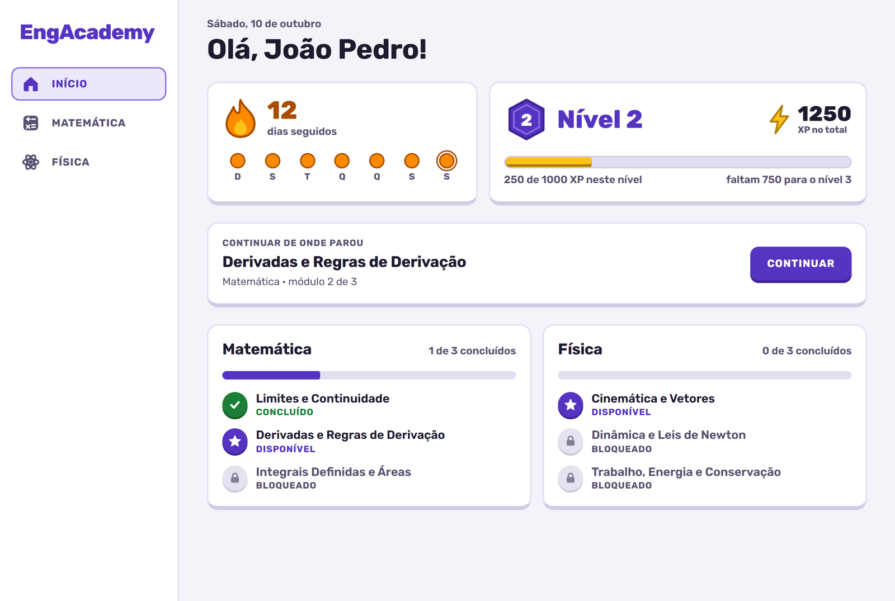
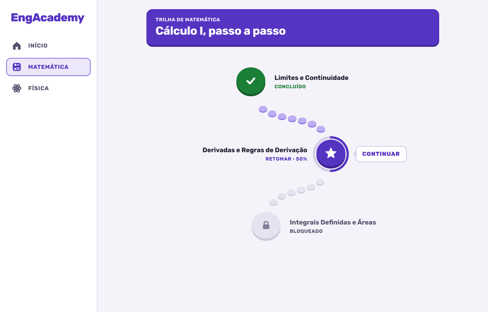
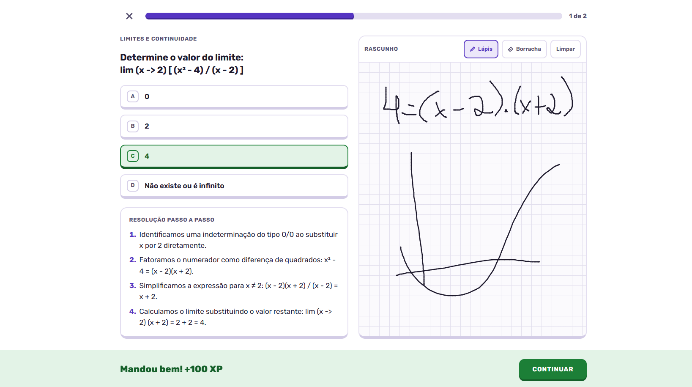
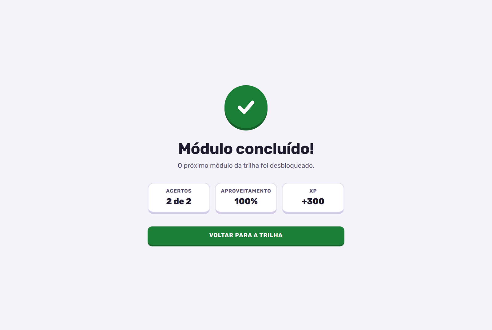

# EngAcademy

Plataforma web gamificada para o nivelamento em **Matemática (Cálculo I)** e **Física (Física I)** de estudantes ingressantes em cursos de Engenharia.

Protótipo desenvolvido como Trabalho de Conclusão de Curso de Engenharia da Computação no Centro Universitário Internacional UNINTER.

- **Autor:** William Alves Ferraz
- **Orientador:** Prof. Allan Christian Krainski Ferrari



## Telas

| Trilha de aprendizagem | Lição com rascunho |
|---|---|
|  |  |

| Resultado da lição |
|---|
|  |

## Funcionalidades

Os identificadores correspondem aos requisitos especificados no artigo.

| Requisito | Comportamento |
|---|---|
| RF-001 | Conteúdo organizado em trilhas verticais de módulos e questões. |
| RF-002 | O módulo seguinte só é liberado com aproveitamento igual ou superior a 70% no anterior. |
| RF-003 | Pontos de experiência (XP) por acerto e bônus apenas na primeira aprovação de cada módulo. |
| RF-004 | Sequência de dias consecutivos de estudo, sem dupla contagem no mesmo dia. |
| RF-005 | Resolução passo a passo exibida após cada resposta, certa ou errada. |
| RF-006 | Progresso preservado entre sessões do navegador. |

Além disso, cada lição tem uma **folha de rascunho** para cálculos à mão (mouse, caneta ou toque), salva por lição no navegador.

## Regras do motor de gamificação

| Regra | Valor | Onde está |
|---|---|---|
| Aproveitamento mínimo para aprovação | 70% | `src/config/gamification.ts` |
| XP por questão correta | 100 | `src/config/gamification.ts` |
| Bônus na primeira aprovação do módulo | 100 | `src/config/gamification.ts` |
| XP por nível | 1000 | `src/config/gamification.ts` |
| Cálculo de nível e aproveitamento | funções puras | `src/lib/progression.ts` |
| Cálculo da sequência de estudo | funções puras | `src/lib/streak.ts` |

As regras ficam em módulos puros, separados da interface. A tela só chama `submitQuizAttempt`, do `StudentContext`, que aplica as regras e devolve o resultado da tentativa.

## Tecnologias

- [Next.js 16](https://nextjs.org) (App Router)
- [React 19](https://react.dev) com React Context API para o estado global
- [TypeScript](https://www.typescriptlang.org) em modo estrito
- [Tailwind CSS 4](https://tailwindcss.com), com as cores e fontes definidas em `src/app/globals.css`
- Fonte [Rubik](https://fonts.google.com/specimen/Rubik), carregada com `next/font`

Não há dependências de animação: todo o movimento é feito com CSS nativo e respeita a preferência de movimento reduzido do sistema.

## Como executar

Pré-requisito: Node.js 20.9 ou superior.

```bash
npm install
npm run dev
```

Abra [http://localhost:3000](http://localhost:3000).

Para gerar a versão de produção:

```bash
npm run build
npm start
```

O progresso fica salvo no `localStorage` do navegador. Para recomeçar do zero, limpe os dados do site.

## Estrutura do código

```text
src/
├── app/
│   ├── (app)/                 telas com barra de navegação
│   │   ├── page.tsx           tela inicial: sequência, nível, XP e resumo das trilhas
│   │   └── trilhas/           trilhas de Matemática e Física
│   └── licao/[moduleId]/      tela da lição, em tela cheia
├── components/
│   ├── TrilhaVertical.tsx     trilha em zigue-zague com o caminho de pedras
│   ├── trail/                 geometria da trilha e classificação de status
│   ├── lesson/                lição (LessonView) e folha de rascunho (ScratchPad)
│   ├── home/                  cartões da tela inicial
│   ├── Sidebar.tsx            navegação lateral e inferior
│   └── icons.tsx              ícones
├── context/StudentContext.tsx estado global, aplicação das regras e persistência
├── config/gamification.ts     parâmetros do motor de gamificação
├── lib/                       regras puras de progressão e de sequência
├── hooks/                     movimento reduzido, contadores e memória do que já foi visto
├── types/                     contratos de domínio
└── mocks/                     conteúdo das trilhas e das questões
```

## Interface

As cores, a fonte e as decisões visuais estão anotadas em [`docs/interface.md`](docs/interface.md).

## Limitações do protótipo

- O progresso fica no navegador do dispositivo e não acompanha o estudante entre máquinas.
- Cada módulo tem duas questões.
- A progressão é a mesma para todos os estudantes, sem adaptação ao perfil.
